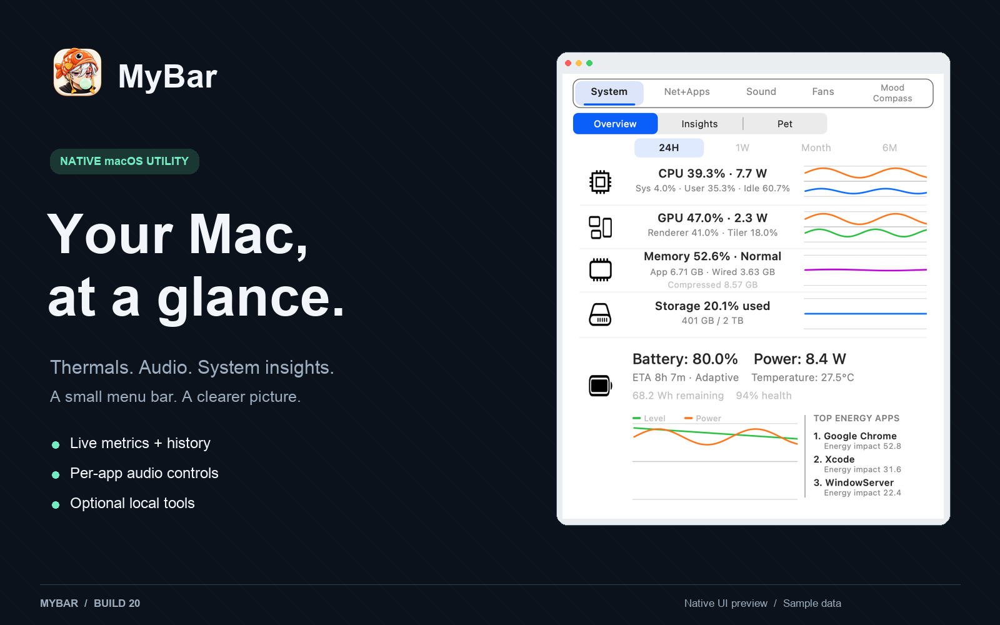
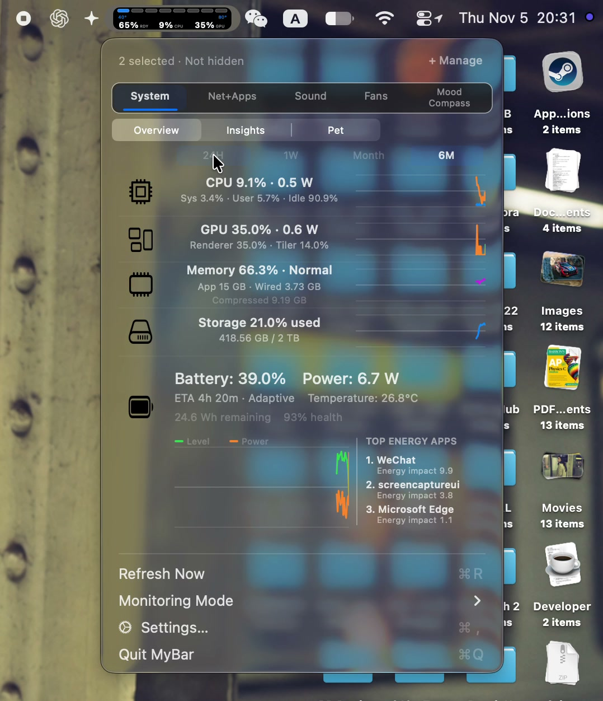
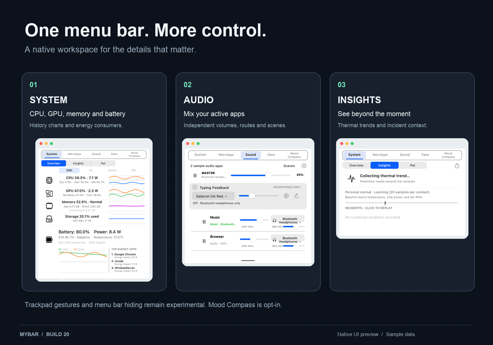

<p align="center"></p>

<p align="center">
  <a href="https://github.com/fish-idle-hat/MyBar/releases/tag/v1.1.20"><strong>Download build 20</strong></a> ·
  <a href="https://github.com/fish-idle-hat/MyBar/releases/download/v1.1.20/MyBar-screen-recording-demo.mp4">Video demo</a> ·
  <a href="#build-from-source">Build from source</a>
</p>

# MyBar

A native macOS menu bar utility for system monitoring, per-app audio and local insights. Temperature, fans, CPU/GPU activity, memory, battery and network live together in one compact interface.

**Version 1.1 · Build 20 · Development preview**  
The downloadable app is for **Apple silicon** and requires **macOS 14.2 or later**. This is an ad-hoc signed, non-notarized development build; macOS may block downloaded copies. Build from source if it does. Hardware and private-API compatibility varies by Mac and macOS version.

## Video demo

<p align="center"><a href="https://github.com/fish-idle-hat/MyBar/releases/download/v1.1.20/MyBar-screen-recording-demo.mp4"></a></p>

**[Watch the screen recording — 1 minute 51 seconds](https://github.com/fish-idle-hat/MyBar/releases/download/v1.1.20/MyBar-screen-recording-demo.mp4)**

A screen recording supplied by the project owner, showing MyBar in actual use. The full recording is presented without cuts or added narration, converted to MP4 for playback. It shows one Mac and session; compatibility on other systems may differ. [Recording details](docs/Media.md).

## What is inside

- **System overview:** CPU/GPU load and power, memory pressure, storage, battery health, estimated runtime and top energy consumers.
- **History and insights:** historical charts, thermal trends, observed personal ranges, sustained alerts and incident replay. Sensor confidence distinguishes unavailable or stale readings.
- **Network + apps:** throughput, Wi-Fi details, latency and process activity.
- **Sound:** per-app volumes and outputs, playback controls, pinned media and saved Sound Scenes. System audio access is requested when the corresponding feature is used.
- **Typing feedback:** optional mechanical switch recordings through eligible Bluetooth headphones. Disabled by default; requires Input Monitoring. Typed content is not stored.
- **Mood Compass:** optional, on-device behavioural estimates and check-ins. Disabled by default. These are estimates, not emotion measurements or medical advice. [Privacy and limitations](docs/MoodCompass.md).
- **Polling choices:** Live, Balanced and Eco modes, rotating sensor batches and cached expensive metrics.



## Current limits

| Feature | Status in this release |
| --- | --- |
| Monitoring and history | Included; available readings depend on the Mac's sensors and permissions. |
| Per-app audio | Included; macOS system-audio permission and supported outputs are required. |
| Fan controls | Optional isolated helper; hardware writes and compatibility require validation on the target Mac. No hardware fan-control success is claimed by this release. |
| Four-finger browser tabs | Experimental, off by default. Build 20 includes the corrected system-gesture conflict guard. Physical browser switching remains unverified. [Setup and limits](docs/TrackpadGestures.md). |
| Menu bar hiding | Experimental macOS 27 hiding is disabled after a preservation failure; its helper is not executable in packaged releases. [Details](MENU_BAR_ORGANIZER.md). |
| Capri desktop companion | Included as unfinished work; further feature development is paused. [Details](PET.md). |

## Install

1. Download **[MyBar-1.1-build20-arm64.zip](https://github.com/fish-idle-hat/MyBar/releases/download/v1.1.20/MyBar-1.1-build20-arm64.zip)** from Releases.
2. Unzip it and move `MyBar.app` to `/Applications`.
3. Launch the installed app. Enable optional features only when needed and review their permission prompts.

Quit an existing MyBar instance before replacing it. Ad-hoc updates may require re-adding the installed `/Applications/MyBar.app` to Input Monitoring or Accessibility. Keep the same installed location. This release does not change trackpad system preferences automatically.

The app was previously named TheBar / ThermoBar. The internal Swift package, executable and `local.thermobar.app` bundle identifier retain the original names to preserve existing preferences and history.

## Build from source

Install Xcode with its command-line tools, then run from the repository root:

```sh
swift test --configuration release -Xswiftc -warnings-as-errors
zsh scripts/build-app.sh "$PWD/outputs"
zsh scripts/verify-release.sh "$PWD/outputs/MyBar.app"
open outputs/MyBar.app
```

The package has no external Swift package dependencies. The build script packages the helper executables, resource bundles and app icon, and signs them ad-hoc. The same script can be run on another supported architecture, but only the Apple silicon artifact is provided here.

## Validation and privacy

The build 20 release suite ran **196 tests: 192 passed, 4 skipped, 0 failures**. Skips cover opt-in audio/performance probes and a debug-path helper check. Packaged release checks cover signatures, pet assets, sound assets, helper protocol, broken-pipe isolation and disabled menu-hiding helper. See [release notes](docs/Release-build20.md).

Monitoring and optional data histories stay on the Mac. Optional features may read foreground-app identity, local activity signals, calendars/reminders or coarse daylight context when enabled and permitted; see each feature guide before opting in. The designed graphics use sample data; the linked video is a screen recording explicitly supplied by the project owner.

## Documentation and assets

[Trackpad gestures](docs/TrackpadGestures.md) · [Typing feedback](docs/TypingFeedback.md) · [Mood Compass](docs/MoodCompass.md) · [Third-party notices](THIRD_PARTY_NOTICES.md)

Code is available under [MIT](LICENSE). The existing character artwork and app icon are excluded from the code license; underlying character rights are not granted. Preserve the [asset rights notice](Sources/ThermoBar/Resources/Pet/ASSET_RIGHTS.md) and third-party notices.
